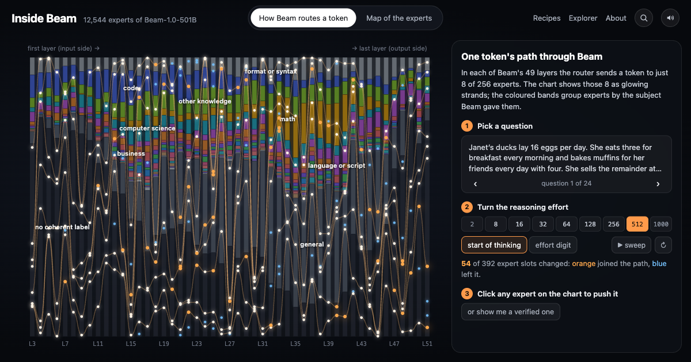

# Inside Beam

By **Swapnil Dutta** (swappy · [rycerzes on Hugging Face](https://huggingface.co/rycerzes) · [GitHub](https://github.com/rycerzes)).

A map of all 12,544 routed experts in [Beam-1.0-501B-A23B](https://huggingface.co/reflection/Beam-1.0-501B-A23B),
12,066 of them pushed inside the running model and checked against random controls (478 lost their data to a time
limit), then labelled by Beam itself. Banning the experts Beam labelled *law* drops MMLU-Pro law by 13 points and leaves every other
subject where it was.

- **Explorer:** [huggingface.co/spaces/rycerzes/inside-beam](https://huggingface.co/spaces/rycerzes/inside-beam)
  (search any expert, read Beam's label for it and what Beam says when it is pushed)
- **Data:** [rycerzes/beam-expert-atlas](https://huggingface.co/datasets/rycerzes/beam-expert-atlas)
- **Write-up:** coming soon on [rycerz.es](https://rycerz.es); until then, the research log below
- **Research log:** [research_log.md](research_log.md), dated entries including what failed and what we corrected
- **Code:** this repo; the vLLM plugin is [`steer/`](steer/)

[](https://huggingface.co/spaces/rycerzes/inside-beam)

Built for Reflection's [Build with Beam](https://huggingface.co/reflection/Beam-1.0-501B-A23B/discussions/5) contest.

## What we found

Each effect below is compared against a matched control. The details, and what did not work, are in the
[research log](research_log.md).

**1. Banning the experts Beam labelled with a subject hurts that subject, and only that subject (three subjects
tested).** We banned the experts Beam labelled with a subject
(exactly, through the router's correction bias) and scored all 12,032 MMLU-Pro questions, paired against a ban of
the same number of random experts with matched routing load. Base accuracy is 62.3% (no thinking, letter scoring).

| Experts banned | Their own subject | Every other subject | Random ban of the same size |
|---|---|---|---|
| law (143) | **−13.4 pts** (p = 1e-21) | +0.2 (ns) | −0.4 |
| health (165) | **−6.5 pts** (p = 4e-8) | −0.1 (ns) | −0.2 |
| math (588) | **−8.7 pts** (p = 3e-14) | physics −9.2, chemistry −7.9, economics −6.2, business −4.8, health −3.7, law −2.2; history, philosophy, psychology ±1 | −0.3 |

The "math" experts carry quantitative work across every number-heavy subject, not math as a topic.

**2. Steering finds real units, mostly in the middle of the network.** We pushed each expert's main write directions
into the residual stream of the live model at calibrated doses (12,920 units with data, including random-direction
controls) and asked whether the outputs drift toward a theme more than controls that move the model by the same
amount. 2,092 expert directions pass, against 1,128 expected by chance; they concentrate in layers 24–39. A blind
judge given three steered outputs picks the right one from the expert's top tokens (what the pushed direction promotes) 70%
of the time for those directions (chance 33%, random directions 49%), and 98.7% of the time on the 670 items it
marked as clear matches. The judge is DeepSeek-V4-Flash via HF Inference Providers (no thinking); pilots used Claude
Sonnet 5.5, Qwen3.8-Flash-Next and Beam itself. Given a label from the other side of the same direction, it is at chance (35%).

**3. Beam knows which of its experts are readable.** Beam named 10,926 expert directions from their top tokens and
flagged whether each label was coherent. Coherent ones pass the steering test 3.5x as often (19.5% vs 5.6%), although
the flag never saw any steering. Coherence rises with depth, from 29% in MoE layers 3–7 to a peak of 90% in layers 32–39. With
Beam's labels in place of raw tokens, the judge scores 71% (vs 49% for random directions).

**4. The reasoning-effort setting is a number Beam reads early and clamps.** A single direction reads the effort N
from the residual at N's last digit with R² = 0.999 (layer 12). Values below the trained 8–512 range read as the bottom
of the scale (at layer 12, N = 2 reads as about 11). On 100 AIME 2024/2025 and AMC 2023 problems at effort 8, adding the difference
between the digit's mean representation at N = 512 and at N = 8 lengthens thinking 1.2x relative to a random vector
of the same norm (p = 5e-8). Low effort is fragile: re-routing 37 "effort experts" on the prompt (19 forced in, 18
banned) or 37 random experts both lift effort-8 accuracy from 80% to 91–94%, the same as raising the dial to 32, so
that gain is not effort-specific.

## How Beam was used

- **As the subject.** Every intervention runs inside the real 501B model: the NVFP4 release in vLLM on 4x RTX PRO
  6000 (HF Jobs), with our plugin adding per-request residual pushes, router-logit changes, exact expert bans and
  activation capture. About 7 hours on 4 GPUs in total.
- **As the labeller.** Beam named 10,926 of its own expert directions (name, description, subject, coherent or not)
  through HF Inference Providers, and those labels picked the experts for the ban experiments.
- **As the measuring stick.** Its effort dial, its default identity line and its answers on MMLU-Pro and competition
  math are the outcomes.

## Tools you can use

- **[`beam-steer`](steer/), a vLLM plugin for Beam.** Per-request residual steering, per-request routing changes,
  exact expert bans for the whole batch, and capture of every layer's residual and router logits at chosen
  positions. Checked against a transformers reference on a tiny Beam built from the real config (below).
- **A pruning check.** Ban any set of experts and score it on MMLU-Pro in about 6 minutes per arm on 4 GPUs, before
  building a pruned checkpoint. Arms are lists of `[layer, expert]` ([`scripts/mmlu_arms.py`](scripts/mmlu_arms.py)).
- **The atlas.** Per expert direction: top tokens, Beam's label and subject, steering significance, judge verdict,
  and Beam's steered outputs ([dataset](https://huggingface.co/datasets/rycerzes/beam-expert-atlas)).
- **Effort activations.** Residuals at every layer and router logits for 200 GSM8K questions at 9 effort settings
  (5 positions each), so effort probes can be trained without running Beam.

## The plugin

Install it into the environment vLLM runs in:

```bash
uv pip install "beam-steer @ git+https://github.com/rycerzes/beam-inside#subdirectory=steer"
# inside the vllm/vllm-openai image, which has pip:
pip install "beam-steer @ git+https://github.com/rycerzes/beam-inside#subdirectory=steer"
```

vLLM finds it through the `vllm.general_plugins` entry point. Beam support landed in vLLM main after 0.32.0, so the
plugin is written and tested against `vllm/vllm-openai:nightly-5d35ce3934a7804b298559d2d99eec33792e1eb9`; later
versions are untested. It needs `VLLM_USE_V2_MODEL_RUNNER=0`, `async_scheduling=False` and
`enable_prefix_caching=False` (cached prompt tokens skip the forward, so they would be neither steered nor captured).

```python
import os
os.environ["VLLM_USE_V2_MODEL_RUNNER"] = "0"
import torch
from vllm import LLM, SamplingParams

llm = LLM("reflection/Beam-1.0-501B-A23B-NVFP4", tensor_parallel_size=4, moe_backend="marlin",
          async_scheduling=False, enable_prefix_caching=False)

# Steering: slot 1 adds `delta` to the residual leaving layer 30 (slot 0 is always unsteered).
delta = torch.randn(5120) * 2.0
torch.save([(1, 30, delta)], "/tmp/steer.pt")
llm.collective_rpc("beam_steer_set", args=("/tmp/steer.pt",))
out = llm.generate(["..."], SamplingParams(max_tokens=200, extra_args={"steer_slot": 1}))

# Exact expert bans, for every request until reset: lower the routing correction bias.
torch.save([(30, 222, -1000.0), (31, 17, -1000.0)], "/tmp/bans.pt")
llm.collective_rpc("beam_steer_set_bias", args=("/tmp/bans.pt",))
llm.collective_rpc("beam_steer_reset_bias")
```

| RPC / request key | What it does |
|---|---|
| `beam_steer_set(path)` | load `[(slot, layer, delta)]`: residual pushes per slot |
| `beam_steer_set_route(path)` | load `[(slot, layer, expert, delta)]`: router-logit changes per slot (force or discourage experts) |
| `beam_steer_set_bias(path)` / `beam_steer_reset_bias()` | `[(layer, expert, delta)]` added to the correction bias for the whole batch; −1000 is an exact ban |
| `beam_steer_capture_dump(path)` | save captured residuals `[layers, rows, hidden]`, router logits and an index (needs `BEAM_STEER_CAPTURE_ROWS`) |
| `extra_args`: `steer_slot`, `steer_from`, `steer_until`, `steer_skip_ids`, `capture`, `capture_key` | per request: which slot, which positions, what to capture |

Why bias bans, not logit bans: Beam picks experts by `sigmoid(logit) + e_score_correction_bias`, and that bias is
18–28 with a spread of at most 0.02 within a layer, so a −30 logit does not guarantee a ban. The bias only enters the
choice, never the routing weights, which is what slicing an expert out of the router amounts to.

**Test.** [`scripts/vllm_tiny_check.py`](scripts/vllm_tiny_check.py) builds a tiny random Beam from the real
`config.json` in the Hub's FP8, BF16 and NVFP4 formats, runs it through transformers and through vLLM with the plugin,
and holds every case (steering slots, windows, skip ids, routing, bias bans and their exact restore, capture) to the
reference within the BF16 floor, in eager mode and with CUDA graphs. `uv run scripts/launch_tiny.py gpu` runs it on
one RTX PRO 6000 for about $0.30.

**Related tools** (as of 2026-10-29): upstream vLLM has no steering API. vllm-lens (UK AISI) reads activations in
vLLM; EasySteer steers residuals and routing but is pinned to vLLM 0.29, before Beam; the RhizoNymph steering fork
has no Beam support. SteerMoE (routing-logit steering) and MoTE (expert switching on DeepSeek-R1) are methods this
builds on.

## Reproduce

Everything ran from this repo on HF Jobs; [`scripts/watch_job.py`](scripts/watch_job.py) relays progress and spend.

| Step | Command | Hardware, time | Cost |
|---|---|---|---|
| Expert write directions from the FP8 weights (range reads, no full download) | `uv run scripts/atlas_experts.py` → `atlas_lens.py` | CPU | — |
| Pick units, directions and controls | `uv run scripts/sweep_units.py` | CPU | — |
| Plugin check on a tiny Beam | `uv run scripts/launch_tiny.py gpu` | 1x RTX PRO 6000, 10 min | $0.30 |
| Calibration, effort capture, full sweep | `uv run scripts/launch_session.py real --repo USER/runs --hours 3.5` | 4x RTX PRO 6000, 3.1 h | $34.28 |
| Rank against effect-matched controls | `uv run scripts/rank_sweep.py RUN` → `effect_rank.py RUN` | CPU | — |
| Effort analysis and competition-math arms | `effort_analysis.py`, `effort2_inputs.py`, session phase `effort2` | 4x RTX PRO 6000, 2.5 h incl. a cancelled first attempt | $28.05 |
| Blind three-way judge (DeepSeek-V4-Flash) | `judge_items.py` → `judge_router.py` → `judge_score.py` | HF Inference Providers | $0.88 |
| Beam labels its experts | `pole_rows.py` → `self_label.py` → `self_label_score.py` | HF Inference Providers (Baseten) | $38.07 |
| Ban arms, MMLU-Pro | `mmlu_arms.py`, session phase `mmlu`, `mmlu_score.py` | 4x RTX PRO 6000, 1 h | $10.87 |
| Public dataset and explorer files | `uv run scripts/export_atlas.py OUT` and `export_captures.py` | CPU | — |

Total spend about $120: ~$81 of GPU time (including an earlier pilot sweep, rehearsals and one cancelled run), $38
of Beam inference and under $1 of judge inference. Run every `uv` command with `UV_NO_CONFIG=1` if your machine has
a global index configured.

<details><summary>What each script does</summary>

| Script | Purpose |
|---|---|
| `fetch_tensors.py`, `ckpt.py` | read individual tensors from a Hub safetensors checkpoint with HTTP range requests |
| `atlas_experts.py`, `atlas_lens.py`, `atlas_dense.py`, `atlas_router.py` | weight-only atlas: experts' top write directions, their logit-lens tokens, dense neurons, router geometry |
| `streamed.py`, `check_tiny.py`, `speedtest.py` | layer-streamed Beam forward (prefill on one GPU) and its tiny-model check; Hub read speed |
| `nvfp4_compare.py` | FP8 vs NVFP4 expert weights: write directions transfer (\|cos\| ≥ 0.997) |
| `sweep_units.py` | units for the sweep: expert directions, dense neurons, random controls |
| `session.py` | the GPU session: sanity, residual stats, calibration, effort, sweep, effort2, mmlu phases |
| `launch_session.py`, `launch_tiny.py`, `watch_job.py` | HF Jobs launchers and spend watcher |
| `vllm_tiny_check.py` | plugin correctness against transformers on a tiny Beam |
| `rank_sweep.py`, `effect_rank.py` | theme scores vs band controls, then vs effect-matched controls |
| `effort_analysis.py`, `effort2_inputs.py` | effort readout, off-dial reads, effort experts; competition-math arm inputs |
| `judge_items.py`, `judge_router.py`, `judge_score.py`, `label_items.py` | blind three-way label test |
| `pole_rows.py`, `self_label.py`, `self_label_score.py` | Beam labels its own expert directions; scoring |
| `mmlu_arms.py`, `mmlu_score.py` | ban arms with load-matched controls, paired MMLU-Pro scoring |
| `export_atlas.py`, `export_captures.py` | public dataset tables, explorer JSON, activation captures |

</details>

## Limitations

- One greedy sample per prompt and problem; the competition-math arms are 100 problems.
- Early MoE layers (3–23) are underdosed in effect terms: their few "significant" directions are at or near chance
  with the judge (27–42% vs 33%),
  so treat them as false positives of the theme metric. Late layers (48+) collapse into repetition at the doses
  needed, and 46% of their directions have no fair control.
- An earlier pilot sweep (not used for the numbers above, not in the dataset) ran with vLLM's prefix caching on, so
  it steered only from the assistant turn onwards.
- 3 of 79 sweep waves were lost to the job's time limit: 478 experts have no steering data.
- Beam's labels describe what an expert writes, read from its top tokens, not when the router uses it.
- Labels and the judge test cover the + side of each direction (the side the sweep's lens tokens describe). A first
  pass also labelled and judged − pushes, but with the + side's tokens; those results are excluded (they sit at
  chance, as a mismatched label should), and about half of the labelling spend went to them.
- MMLU-Pro is scored without thinking, so absolute accuracy (62.3%) is below Beam's reported score with thinking.
- None of this was pre-registered.

## Credits

**Where this started.** [Simon V's post](https://x.com/Simon_Vt/status/2114444548500005044) quoting
[@_lyraaaa_](https://x.com/_lyraaaa_)'s two-neuron "evil Qwen" steering recipe, and Goodfire's essay
[Neural Networks Are Already Clean](https://already-clean.goodfire.com/), which argues most units have one readable job
and that you check a label by steering it.

**Method.**
- Lyra's [neuron-explorer](https://github.com/lyramakesmusic/neuron-explorer): steering-first labelling with random
  controls, doses in units of the median residual norm, the who / snake / orange prompts, and the research-log format.
- [RhizoNymph/vllm](https://github.com/RhizoNymph/vllm), the steering fork of vLLM that neuron-explorer runs on: our
  beam-steer plugin's per-request steering table follows its design (the fork has no Beam support, so we wrote our own).
- Expert steering and bans: SteerMoE ([arXiv 2509.09660](https://arxiv.org/abs/2509.09660)) and MoTE
  ([arXiv 2502.11096](https://arxiv.org/abs/2502.11096)).
- The blind three-way label test: Gur-Arieh et al. ([arXiv 2501.08319](https://arxiv.org/abs/2501.08319)). A model
  describing its own units: Li et al. ([arXiv 2511.08579](https://arxiv.org/abs/2511.08579)). Reasoning strength read
  from activations: Sheng et al. ([arXiv 2506.08390](https://arxiv.org/abs/2506.08390)). Expert-level MoE
  interpretability: Herbst et al. ([arXiv 2604.02178](https://arxiv.org/abs/2604.02178)). The logit lens:
  [nostalgebraist (2020)](https://www.lesswrong.com/posts/AcKRB8wDpdaN6v6ru/interpreting-gpt-the-logit-lens).
- Static weight analysis of Beam: [Barneyjm/beam-teardown](https://github.com/Barneyjm/beam-teardown).

**Model, serving and compute.** Reflection's [Beam-1.0-501B-A23B](https://huggingface.co/reflection/Beam-1.0-501B-A23B)
and its [NVFP4 release](https://huggingface.co/reflection/Beam-1.0-501B-A23B-NVFP4) (Apache-2.0), served with
[vLLM](https://github.com/vllm-project/vllm) following its [Beam recipe](https://recipes.vllm.ai/reflection/Beam-1.0-501B-A23B);
transformers' Beam implementation for the reference checks; HF Jobs for the GPU runs; HF Inference Providers for
Beam's labels (Baseten) and the judge, DeepSeek-V4-Flash (DeepInfra). Pilot judges: Claude Sonnet 5.5,
Qwen3.8-Flash-Next and Beam itself.

**Data.** [MMLU-Pro](https://huggingface.co/datasets/TIGER-Lab/MMLU-Pro), [GSM8K](https://huggingface.co/datasets/openai/gsm8k),
[AIME 2024](https://huggingface.co/datasets/HuggingFaceH4/aime_2024), [AIME 2025](https://huggingface.co/datasets/MathArena/aime_2025),
[AMC 2023](https://huggingface.co/datasets/math-ai/amc23), [WikiText-103](https://huggingface.co/datasets/Salesforce/wikitext)
(statistics only). The ban controls are matched on per-expert routing counts from the REAP calibration file
(`reap_saliency.json` in [mrfakename/Beam-1.0-REAP-255B-A23B](https://huggingface.co/mrfakename/Beam-1.0-REAP-255B-A23B),
Apache-2.0).

**The site.** Built on Thibaud Frere's [research article template](https://huggingface.co/spaces/tfrere/research-article-template)
(CC BY 4.0). The push panel's strength control follows
[Neuron Studio](https://huggingface.co/spaces/webml-community/neuron-studio), the recipes follow
[Neuronary](https://neuronary.org/), the map follows [Neuronpedia](https://www.neuronpedia.org/)'s feature maps, and the
route view follows the data-flow overview of Polo Club's [Transformer Explainer](https://github.com/poloclub/transformer-explainer). Charts with [D3](https://d3js.org/); the map layout with [UMAP](https://github.com/lmcinnes/umap).

**The contest.** Reflection and Hugging Face's [Build with Beam](https://huggingface.co/reflection/Beam-1.0-501B-A23B/discussions/5)
([announcement](https://huggingface.co/blog/reflection-beam)). Not affiliated with Reflection.

## References

- Cho, A., Kim, G. C., Karpekov, A., et al. (2024). Transformer Explainer: Learning LLM Transformers with Interactive Visual Explanation and Experimentation. [arXiv:2408.04619](https://arxiv.org/abs/2408.04619).
- Cobbe, K., Kosaraju, V., Bavarian, M., et al. (2021). Training Verifiers to Solve Math Word Problems (GSM8K). [arXiv:2110.14168](https://arxiv.org/abs/2110.14168).
- Dahlke, R., Klagges, H., Zecha, D., Merkel, B., et al. (2025). Mixture of Tunable Experts: Behavior Modification of DeepSeek-R1 at Inference Time. [arXiv:2502.11096](https://arxiv.org/abs/2502.11096).
- Fayyaz, M., Modarressi, A., Deilamsalehy, H., Dernoncourt, F., et al. (2025). Steering MoE LLMs via Expert (De)Activation. [arXiv:2509.09660](https://arxiv.org/abs/2509.09660).
- Frere, T. (2025). Research Article Template. [Hugging Face Space](https://huggingface.co/spaces/tfrere/research-article-template).
- Goodfire (2026). Neural Networks Are Already Clean. [already-clean.goodfire.com](https://already-clean.goodfire.com/).
- Gur-Arieh, Y., Mayan, R., Agassy, C., et al. (2025). Enhancing Automated Interpretability with Output-Centric Feature Descriptions. [arXiv:2501.08319](https://arxiv.org/abs/2501.08319).
- Herbst, J., Wermter, S., Lee, J. H. (2026). The Expert Strikes Back: Interpreting Mixture-of-Experts Language Models at Expert Level. [arXiv:2604.02178](https://arxiv.org/abs/2604.02178).
- Kwon, W., Li, Z., Zhuang, S., et al. (2023). Efficient Memory Management for Large Language Model Serving with PagedAttention (vLLM). [arXiv:2309.06180](https://arxiv.org/abs/2309.06180).
- Li, B. Z., Guo, Z. C., Huang, V., et al. (2025). Training Language Models to Explain Their Own Computations. [arXiv:2511.08579](https://arxiv.org/abs/2511.08579).
- Lyra (2026). neuron-explorer: steering-first neuron labelling. [github.com/lyramakesmusic/neuron-explorer](https://github.com/lyramakesmusic/neuron-explorer).
- McInnes, L., Healy, J., Melville, J. (2018). UMAP: Uniform Manifold Approximation and Projection for Dimension Reduction. [arXiv:1802.03426](https://arxiv.org/abs/1802.03426).
- Merity, S., Xiong, C., Bradbury, J., et al. (2016). Pointer Sentinel Mixture Models (WikiText). [arXiv:1609.07843](https://arxiv.org/abs/1609.07843).
- nostalgebraist (2020). Interpreting GPT: the logit lens. [LessWrong](https://www.lesswrong.com/posts/AcKRB8wDpdaN6v6ru/interpreting-gpt-the-logit-lens).
- Reflection (2026). Beam-1.0-501B-A23B. [Hugging Face model card](https://huggingface.co/reflection/Beam-1.0-501B-A23B).
- Sheng, L., Zhang, A., Wu, Z., et al. (2025). On Reasoning Strength Planning in Large Reasoning Models. [arXiv:2506.08390](https://arxiv.org/abs/2506.08390).
- Wang, Y., Ma, X., Zhang, G., et al. (2024). MMLU-Pro: A More Robust and Challenging Multi-Task Language Understanding Benchmark. [arXiv:2406.01574](https://arxiv.org/abs/2406.01574).

## Cite

```bibtex
@misc{dutta2026insidebeam,
  title        = {Inside Beam: steering, labelling and banning the experts of Beam-1.0-501B},
  author       = {Dutta, Swapnil},
  year         = {2026},
  howpublished = {\url{https://huggingface.co/spaces/rycerzes/inside-beam}},
  note         = {Code: https://github.com/rycerzes/beam-inside; data: https://huggingface.co/datasets/rycerzes/beam-expert-atlas}
}
```

Code is Apache-2.0. `meta/config.json` and `meta/chat_template.jinja` are Reflection's, from the Beam model repo
(Apache-2.0).
